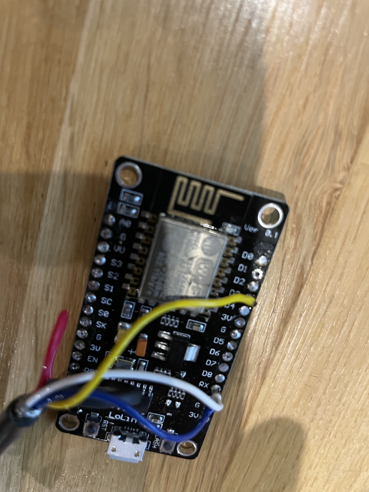

# CB19 gate control with ESP32 and Tasmota

[gate.be](gate.be) connects a TMT CB19 gate controller to Home Assistant over local HTTP and to Homebridge over MQTT. The ESP32 reads the gate position over serial, displays all 19 controller settings and provides controls for pairing a remote and learning gate travel. The TMT CHOW cloud service is optional.

This driver has been used with Tasmota32 14.4.1 and a CB19 reporting `P190,PS17062E,V0.3` through `READ DEVINFO`. The gate dashboard, controller settings and learning forms are available in Dutch, English and German. The original hardware photos and serial captures are included [below](#hardware-and-protocol-notes).

For Apple Home, follow the [Homebridge installation and upgrade guide](#mqtt-and-homebridge).

## Home Assistant via HACS

Install the ESP application and the Home Assistant integration from the same release (v1.1.0 or later). One installation of the integration supports multiple CB19 controllers.

1. In HACS, open the menu → **Custom repositories**. Enter `https://github.com/RPJacobs/CB19-GATE-CONTROL-SYSTEM`, choose **Integration**, then download **CB19 Gate** and restart Home Assistant. For a manual installation, copy `custom_components/cb19_gate` into the matching directory inside your HA configuration folder.
2. Open **Settings → Devices & services**. Confirm each discovered CB19 and give it a name, for example *Driveway* or *Garden*. Enter the Tasmota web credentials if configured. When multicast cannot cross VLANs, choose **Add integration → CB19 Gate** and enter its hostname or IP address. Manual entries can also accept a new address through discovery.
3. Each device provides two gate covers (open, close, stop) and a selector for all eight F9 delays and Off. Closing either cover sends the CB19 full-close command. HA verifies the ESP identity before commands. Tasmota MQTT may remain enabled for other clients.
4. To use the animated card, add `/cb19-gate-card/cb19-gate-card.js` once as a **JavaScript module** in Dashboard Resources. When migrating from the standalone card, replace its existing resource URL. Add a **Manual** card for each gate, selecting the entity ID of its **Both gates** cover from the device page:

   ```yaml
   type: custom:cb19-gate-card
   entity: cover.driveway_both_gates
   ```

The ESP advertises `_cb19-gate._tcp.local.` on port 80. Its Wi-Fi MAC is the device identity and the prefix for its MQTT topics. The HTTP identity response at `/hek-data?identity=1` contains only the product, API version and device ID. The dashboard and command routes use the existing Tasmota web access settings. A firmware build without the Berry mDNS module can still use manual HTTP setup.

## App screenshots


<details>
<summary>View all 19 CB19 controller settings</summary>


</details>

## Install the dashboard on Tasmota32

[**Download CB19-Gate.tapp**](https://github.com/RPJacobs/CB19-GATE-CONTROL-SYSTEM/releases/latest/download/CB19-Gate.tapp) · [All releases](https://github.com/RPJacobs/CB19-GATE-CONTROL-SYSTEM/releases)

For an ESP32 running Tasmota32 with Berry, filesystem, web server and MQTT support. The driver uses **GPIO17 RX, GPIO16 TX, 9600 baud, 8N1**. Check your board's serial interface and voltage levels. Configure your broker in Tasmota if you use Homebridge. Keep MQTT movement commands non-retained.

1. Download **CB19-Gate.tapp** and keep the file intact.
2. In Tasmota open **Tools → Manage File system**, select the file and click **Upload** in the filesystem root.
3. With the gate stationary and in view, **restart** the ESP. Click **Hekoverzicht** on the Tasmota home page or open `/hek`. Check the reported gate position and **READ DEVINFO**.

The app contains the driver, dashboard and language files. The two-leaf diagram shows the CB19 position. The dashboard opens either the pedestrian gate or both leaves, closes the gate, stops either opening or closing movement, and controls F9 automatic closing. The language selector remembers the choice in each browser.

### Upgrade or roll back

- **Earlier single-file release** — download the new package, replace **CB19-Gate.tapp** under the same name and restart. To roll back, upload the previous release with the same filename and restart. Keep just one active CB19 application.
- **Earlier loose-file installation** — download a backup of the current gate scripts and root `autoexec.be`. Remove only the CB19 startup lines for `gate.be` or `hek.be` and `hekweb.be`. Move those loose driver files and matching `.bec` files out of the root, or rename them with a `.bak` suffix. If you previously used `Hekoverzicht.tapp`, download a backup and remove it from the ESP. Upload the new package and restart once. Keep other startup lines and apps. The packaged driver skips startup when it detects the old files. To roll back, remove the new package, restore your backups and restart.

### Change translations or publish a release

Edit [nl.json](app/nl.json), [en.json](app/en.json) or [de.json](app/de.json) and keep the keys consistent. Run `python3 app/build.py` from the repository to build `dist/CB19-Gate.tapp`. Maintainers can publish the build from **Actions → Publish Tasmota application → Run workflow** on `main` by entering a new version such as `v1.1.0`. The release attaches the package built from that commit.

## Standalone driver installation

1. Use an ESP32 running Tasmota with Berry, MQTT, the web server and filesystem enabled. The driver opens GPIO17 as RX and GPIO16 as TX at 9600 baud, 8 data bits, no parity and one stop bit. Check the serial interface and logic levels for your board before connecting it.
2. Configure your broker in Tasmota and back up the current Berry driver and `autoexec.be`. On an upgrade, check the MQTT mappings below. Movement commands should be published with **retain off**. A broker can replay a retained command when the ESP reconnects.
3. Upload [gate.be](gate.be) to the root of the ESP filesystem using **Manage File System**. Add the following line to `autoexec.be`, keeping your other startup scripts. If the installed driver is named `hek.be`, use that name in the load line instead. Load a single copy of the driver.

   ```berry
   load("gate.be")
   ```

4. With the gate in sight and the travel area clear, restart the ESP. Open its home page. Under **Gate Percentage**, the **READ DEVINFO** row shows the identity returned by your controller, for example `P190,PS17062E,V0.3`. The ESP requests it when the gate driver is idle and retries after 30 seconds if no valid reply arrives. The settings below start with **F9 Automatisch sluiten**. To refresh the identity manually, run `Hek.send("READ DEVINFO")` in the Berry console. The reply updates the row and also appears on `cb19/<device-id>/hek/serial`.

For filesystem and startup details, see the [Tasmota Berry documentation](https://tasmota.github.io/docs/Berry/).

## ESP web controls

| Home-screen button | What it does |
| --- | --- |
| **CB19-instellingen wijzigen** | Opens the settings editor at `/cb19`. Select one of F1–F9 or FA–FJ, choose a value and press **Wijziging opslaan**. The ESP checks for standstill, reads the full settings frame, changes one field and reads the result back. |
| **AB inleren** | Opens the hand-transmitter form. Press **Handzender inleermodus starten**, then press the button on the remote. The page displays the controller’s `LearnStart` and `LearnComplete` events when received. |
| **Hek inleren** | Opens the gate travel-learning form. The cycle **moves the gate leaves**. Stand by the gate, check that the travel area is clear, tick the confirmation and press **Inleercyclus starten**. The ESP requests a fresh gate position before sending `AUTO LEARN`. |
| **Inleerstatus** | Opens `/inleren`. Press **Inleerstatus uitlezen** to request `READ LEARN STATUS` at any time. During learning, the ESP polls approximately every three seconds and displays both the latest status reply and the latest learning event. |

The two start buttons use separate commands, `REMOTE LEARN` for a transmitter and `AUTO LEARN` for gate travel. For example, `ACK LEARN STATUS:SYSTEM LEARN COMPLETE` describes the **gate travel** result. Look for **LearnComplete** after starting transmitter pairing to see its completion event. Automatic monitoring runs for up to one minute for a transmitter or five minutes for gate travel. If monitoring times out, check the gate and request its status again.

### Controller settings

The home page shows the decoded value and the raw controller code in brackets. These codes are useful when comparing the screen with the manual or a serial capture.

| Setting | Meaning |
| --- | --- |
| F1 | Motor feedback mode |
| F2 / F3 | Opening and closing current limits. In Hall-sensor mode, F3 sets additional closing current. |
| F4 / F5 / F6 | Opening, closing and deceleration speeds |
| F7 / F8 | Delay between the leaves during opening and closing |
| F9 | Automatic closing delay |
| FA / FB / FC | Safety input mode, pedestrian mode and warning light |
| FD / FE | Photocells 1 and 2 |
| FF / FG / FH | Buzzer, electric lock and display orientation |
| FI / FJ | Number of leaves and reversal on closing overcurrent |

For **F9**, the web editor supports every delay in the table. The MQTT autoclose switch uses a fixed three-minute delay when switched on.

| Raw F9 value | 0 | 1 | 2 | 3 | 4 | 5 | 6 | 7 | 8 |
| --- | --- | --- | --- | --- | --- | --- | --- | --- | --- |
| Delay | Off | 3 s | 10 s | 20 s | 40 s | 60 s | 120 s | 180 s | 300 s |

## Hardware manuals

The [PAPILLON250 articulated-arm opener manual](PAPILLON250.pdf) covers the CB19 with controller ID `PS17062E`. The page numbers below are printed in the manual. The cover and contents add two pages in a PDF viewer.

| Procedure | Section | Printed pages |
| --- | --- | --- |
| Pair a remote and select OSC (open–stop–close) or PED (pedestrian) with the board’s RF Learn button | 3.1–3.2 | 8–9 |
| Learn gate travel | 3.3.2 | 10 |
| Look up controller settings, including F9 automatic closing | 5.1–5.2 | 12–13 (F9 on 13) |

The [CB19 control-box manual](CB19U-34100-125-10-C_CB19_manual_std_Wi-Fi_au.pdf) also documents the controller parameters and operating logic in sections 7.2–7.3. TMT Automation hosts the [PAPILLON250 manual on its website](https://www.tmt-automation.us/_upload/files/3410012416BPS17062EPAPILLONCB19manualen.pdf).

## MQTT and Homebridge

The v1.1.0 ESP application gives each controller its own MQTT topics. Homebridge Easy MQTT connects directly to your broker and exposes three accessories in Apple Home. Home Assistant is optional.

| Apple Home accessory | What it controls |
| --- | --- |
| Both gates | Opens both leaves. Closing sends the controller’s full-close command. |
| Pedestrian gate | Opens the pedestrian leaf. Closing **also closes the whole gate**, including the large leaf if it is open. |
| Automatic closing (F9) | Switching on sets the delay to **3 minutes**. Switching off disables automatic closing. If you set another delay on the dashboard, the switch shows **On** for any nonzero delay. |

### 1. Collect the values for your controller

Install the [Tasmota dashboard](#install-the-dashboard-on-tasmota32) or [standalone driver](#standalone-driver-installation) from v1.1.0 or later. In Tasmota, open **Configuration → Configure MQTT** and connect the ESP to your MQTT broker. Use the following values throughout the example.

| Replace in the example | Where to find your value |
| --- | --- |
| `mqtt://mqtt.example.org:1883` | Use your broker’s URL and port as reachable from Homebridge. Configure the same broker on the ESP. If it requires a login, enter the broker username and password in each accessory’s MQTT settings. |
| `aabbccddeeff` | Open `/hek-data?identity=1` on the ESP and copy the `id` field. With the standalone driver, run `Status 5` in the Tasmota console and take `StatusNET.Mac` in lowercase without colons. The ID stays the same when DHCP changes the ESP’s IP. |
| `tele/DrivewayGate/LWT` | Use the ESP’s actual availability topic. With the default Tasmota FullTopic, this is `tele/<Tasmota Topic>/LWT`. Copy **Topic** from Configure MQTT, preserving capitalization. If you customized **FullTopic**, use its corresponding telemetry path. The online payload is `Online`. |

For a second controller, use its own device ID, Tasmota **Topic** and MQTT **Client** ID. Give its three Homebridge accessories distinct names and `info.id` values. Both controllers can share the same broker.

### 2. Configure Homebridge Easy MQTT

1. In **Homebridge UI → Plugins**, install **Homebridge Easy MQTT** (`homebridge-easy-mqtt`). The example uses the configuration format of version 2.2.1.
2. Open **JSON Config**. For a new Easy MQTT setup, add the object below to the existing top-level `platforms` array. If Easy MQTT already serves other devices, merge just these three entries into its `accessories` array. If your gate already has tiles, [update them in place](#upgrade-existing-homebridge-accessories).
3. Replace the example broker, device ID and availability topic throughout. Keep the expressions after `|` on the two outgoing door topics. They convert HomeKit’s `open` and `closed` into the numeric payloads the controller accepts. Leave MQTT **retain off** for movement commands so reconnecting cannot replay an earlier command.
4. Save and restart the Homebridge instance running Easy MQTT, or its child bridge if configured. If the bridge is already paired, open Apple Home to see the accessories. On a new installation, choose **Add Accessory** in Apple Home and scan the QR code for the bridge running Easy MQTT.

```json
{
  "platform": "HomebridgeEasyMQTT",
  "name": "HomebridgeEasyMQTT",
  "accessories": [
    {
      "info": { "id": "driveway-both", "name": "Driveway gate", "type": "GarageDoorOpener" },
      "mqtt": { "broker": "mqtt://mqtt.example.org:1883" },
      "topicGetCurrentDoorState": "cb19/aabbccddeeff/gate/getCurrentDoorState",
      "topicGetTargetDoorState": "cb19/aabbccddeeff/gate/getTargetDoorState",
      "topicSetTargetDoorState": "cb19/aabbccddeeff/hek/set/percentage|value === 'open' ? 100 : value === 'closed' ? 0 : undefined",
      "valueDoorStateOpen": "open",
      "valueDoorStateClosed": "closed",
      "valueDoorStateOpening": "opening",
      "valueDoorStateClosing": "closing",
      "valueDoorStateStopped": "stopped",
      "topicGetAvailable": "tele/DrivewayGate/LWT",
      "valueAvailable": "Online"
    },
    {
      "info": { "id": "driveway-ped", "name": "Driveway pedestrian gate", "type": "GarageDoorOpener" },
      "mqtt": { "broker": "mqtt://mqtt.example.org:1883" },
      "topicGetCurrentDoorState": "cb19/aabbccddeeff/gate/getCurrentPedState",
      "topicGetTargetDoorState": "cb19/aabbccddeeff/gate/getTargetPedState",
      "topicSetTargetDoorState": "cb19/aabbccddeeff/hek/set/ped_percentage|value === 'open' ? 25 : value === 'closed' ? 0 : undefined",
      "valueDoorStateOpen": "open",
      "valueDoorStateClosed": "closed",
      "valueDoorStateOpening": "opening",
      "valueDoorStateClosing": "closing",
      "valueDoorStateStopped": "stopped",
      "topicGetAvailable": "tele/DrivewayGate/LWT",
      "valueAvailable": "Online"
    },
    {
      "info": { "id": "driveway-autoclose", "name": "Driveway automatic closing", "type": "Switch" },
      "mqtt": {
        "broker": "mqtt://mqtt.example.org:1883",
        "onConnect": [
          { "topic": "cb19/aabbccddeeff/hek/autoclose/start", "message": "status" }
        ]
      },
      "topicGetOn": "cb19/aabbccddeeff/hek/autoclose/state",
      "topicSetOn": "cb19/aabbccddeeff/hek/autoclose/cmd",
      "valueOn": "ON",
      "valueOff": "OFF",
      "topicGetAvailable": "tele/DrivewayGate/LWT",
      "valueAvailable": "Online"
    }
  ]
}
```

### Upgrade existing Homebridge accessories

An ESP upgraded from v1.0.x to v1.1.0 stops publishing and listening on the old shared gate topics. Update every client that uses those topics, including MQTT automations. If your three Easy MQTT accessories already match the example for your own ESP, the migration is complete.

| Existing configuration | Change for v1.1.0 |
| --- | --- |
| Reads on `/gate/…` or `/hek/…` and writes on `/hek/…` | Add `cb19/<device-id>` before each suffix for both doors and F9. The full topic starts with `cb19/` and is case-sensitive. |
| F9 refresh on connection | Change the topic inside `mqtt.onConnect` to `cb19/<device-id>/hek/autoclose/start`. The `status` message requests fresh position and F9 reports. |
| Raw commands on `/test` | Move clients that send commands such as `FULL OPEN` or `STOP` to `cb19/<device-id>/cmd/move`. The two Easy MQTT door accessories above use the numeric command topics. |
| Availability on the three accessories | Set each `topicGetAvailable` to the ESP’s Tasmota LWT topic. It follows the Tasmota topic layout independently of the CB19 device prefix. |

Back up your Homebridge configuration before editing. Keep the existing bridge pairing and each Easy MQTT accessory’s `info.id`, type and name. Editing these mappings in place keeps the same accessory identities for existing rooms, scenes and automations. If you are switching from **MQTTthing** to **Easy MQTT** as well, these plugins have different configuration formats. Check the new tiles and their scene and automation assignments in Apple Home before removing the old accessories.

### Verify without moving the gate

In **Homebridge UI → Accessories**, check that both door states and the F9 switch agree with the ESP dashboard. To verify the MQTT path independently, substitute your broker and controller values below. With Mosquitto clients installed, run this subscription first and leave it open.

```sh
mosquitto_sub -h mqtt.example.org -p 1883 -v \
  -t 'tele/DrivewayGate/LWT' \
  -t 'cb19/aabbccddeeff/gate/+' \
  -t 'cb19/aabbccddeeff/hek/autoclose/state'
```

From a second terminal, request a fresh report. This only reads the controller’s position and settings.

```sh
mosquitto_pub -h mqtt.example.org -p 1883 \
  -t 'cb19/aabbccddeeff/hek/autoclose/start' -m status
```

Use your broker’s usual authentication and TLS options if required. For a fully closed gate, look for `closed` on both `getCurrentDoorState` and `getCurrentPedState`. The F9 response is `ON` or `OFF`. If Apple Home shows **No Response**, check the broker connection and the exact LWT topic and payload. If LWT is `Online` but the states stay stale, compare the device ID in the subscription and refresh topic, then check the position in the ESP dashboard. If state updates work but opening from Apple Home does not, check the outgoing topic and its numeric conversion against the example.

### MQTT topic reference

The entries below are **suffixes**. Prepend `cb19/<device-id>` to each one. The Easy MQTT plugin also documents its [garage door settings](https://github.com/mpatfield/homebridge-easy-mqtt/wiki/GarageDoorOpener) and [MQTT connection settings](https://github.com/mpatfield/homebridge-easy-mqtt/wiki/MQTT-Setup).

| Homebridge mapping | Full gate | Pedestrian gate |
| --- | --- | --- |
| Send a target | `/hek/set/percentage` · `100` or `99` opens, `0` closes | `/hek/set/ped_percentage` · `25` opens, `0` closes the gate |
| Read current position | `/hek/percentage` | `/hek/ped_percentage` |
| Read current door state | `/gate/getCurrentDoorState` | `/gate/getCurrentPedState` |
| Read target door state | `/gate/getTargetDoorState` | `/gate/getTargetPedState` |
| Read movement direction | `/gate/getState` | `/gate/getPState` |

For a Homebridge garage-door accessory, map current state to `open`, `closed`, `opening`, `closing` and `stopped`. Map target state to `open` and `closed`, and publish the numeric payload for the selected target. Motion feedback uses `INCREASING`, `DECREASING` and `STOPPED`. The legacy pedestrian target alias `/gate/getTargetDoorPState` publishes `Open` and `Closed`.

Both Homebridge door tiles receive confirmed endpoints, including after an MQTT reconnect. A pedestrian-only cycle keeps the large leaf closed. The pedestrian percentage uses 0 when closed and 25 at the open endpoint. A dual movement supplies one combined percentage.

For stop diagnostics, open `/hek-data?stoplog=1` on the ESP. Each entry contains milliseconds since boot and a controller message or local movement command (`TX`). The ESP keeps the latest 24 entries in RAM, records changes of travel state and skips repeated polling replies. Restarting the ESP clears this history. Capture the log after a naturally occurring stop and note what happened. The controller reports `SINGLE STOPPED` and `DUAL STOPPED` for interrupted travel. An obstruction indication in HomeKit needs a separately identified cause and a verified clear signal.

| Other MQTT topics | Payload or result |
| --- | --- |
| `/hek/autoclose/cmd` | Send `ON` for F9 = 7 (180 s) or `OFF` for F9 = 0. |
| `/hek/autoclose/state` | Read `ON` for any nonzero F9 delay or `OFF` for zero. |
| `/hek/autoclose/start` | Publish any payload to request a fresh position and settings report. |
| `/hek/serial` | Subscribe to read controller replies and events. |
| `/cmd/move` | Accepts `READ DEVINFO`, `READ FUNCTION`, `FULL OPEN`, `PED OPEN`, `FULL CLOSE` and `STOP`. |

## Hardware and protocol notes

The original project replaced the TMT CHOW Wi-Fi module to keep control local. The module header is marked `RST`, `V5`, `RX`, `TX` and `GND`. These are the original module and ESP photos.

<table>
<tr><td>


</td></tr>
<tr><td>

</td><td>

</td></tr>
</table>



The original capture setup used [tmt-reverse.ino](tmt-reverse.ino) and [esp-link](https://github.com/jeelabs/esp-link) to observe traffic between the CHOW module and the CB19. [server.php](server.php) emulates the controller for the module. [commands.php](commands.php) records the serial commands. A position request and an unsolicited close event look like this on the wire.

```text
READ STATUS;src=P0004A83
ACK STATUS:FULL CLOSED,0
$V1PKF0,17,Closed;src=0001
```

The CB19 returns all settings in one `ACK READ FUNCTION` reply and expects a full `WRITE FUNCTION` frame. The editor preserves the other 18 fields, their order and their original padding. This example is a read from the original project.

```text
ACK READ FUNCTION,1:1,2:01,3:01,4:4,5:4,6:4,7:1,8:2,9:7,A:1,B:1,C:0,D:1,E:0,F:0,G:0,H:1,I:2,J:0;src=P0004A83
```


